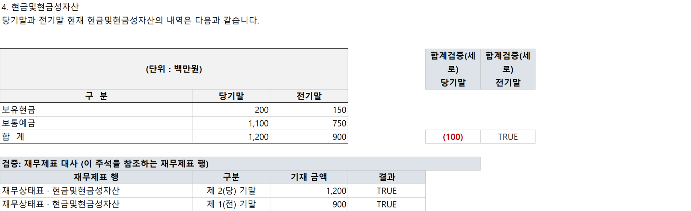
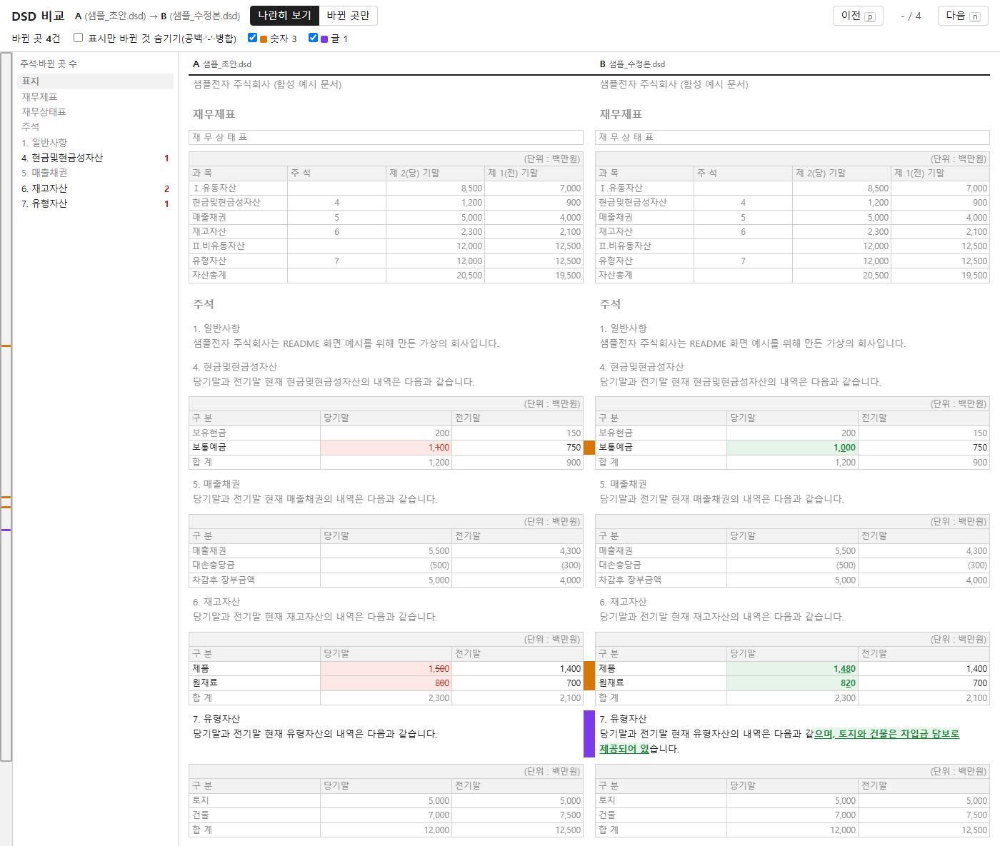

# dsdxlsx - DART DSD ↔ XLSX 왕복 변환

DART 전자공시 편집기 문서(DSD)를 엑셀로 열어 고치고 다시 DSD로 되돌리는 명령줄 도구다.
고치지 않은 부분은 바이트 그대로 남기므로, 아무것도 안 고치고 왕복하면 원본과 같은 파일이 나온다.
재무제표와 주석의 합계·대사를 검산하고 두 판의 차이를 보는 일도 한다.
감사보고서와 분·반기 검토보고서를 작성하거나 검토하는 회계사·공시 담당자를 위해 만들었다.

## 할 수 있는 일

| 하는 일 | 명령 |
|---|---|
| DSD를 엑셀로 열어 고치고 다시 DSD로 되돌린다. 주석의 표·문단·주석 자체를 넣고 뺄 수 있다 | `export`, `import`, `renumber` |
| 합계, 재무제표↔주석 대사, 숫자 표기를 규칙으로 검산한다. 결과는 엑셀 수식으로 남아 값을 고치면 바로 다시 계산된다 | `check`, `recheck`, `refoot` |
| DSD를 검토용 워크북으로 만든다. 총괄표와 재무제표·주석 시트에 합계와 대사 수식이 들어 있어 틀린 곳이 빨간 차이로 보인다 | `foot` |
| 두 DSD에서 화면에 보이는 차이를 HTML 한 장으로 보여 준다 | `diff` |
| 전기 DSD로 당기 기초 DSD와 정산표를 만든다 | `rollforward` |
| 직전 분·반기 DSD로 다음 분기 DSD를 만들고, 당기 칸을 조서에서 채운다 | `roll-interim`, `fill`, `build` |
| 더존(위하고)·세무사랑에서 내려받은 분개장과 재무제표로 TB(계정별 당기·전기 금액과 분류)를 만든다 | `tb` |
| 뼈대 DSD의 행 그대로 정산표를 만들어 TB와 수식으로 잇고, 그 연결이 DSD까지 이어지는지 왕복으로 확인한다 | `link` |
| DSD 숫자를 조서(최종분석적검토, 정산표)와 칸마다 맞춰 본다 | `recon` |
| 한공회 공시사항점검표의 해당 여부와 주석 번호를 채운다 | `disc` |
| 엑셀 없이 DSD를 읽고(목차, 찾기, 마크다운·JSON) JSON 편집 목록으로 고친다. 모든 명령이 `--json` 결과를 내서 LLM이나 스크립트가 쓰기 좋다 | `inspect`, `apply` |
| DART에 공시된 감사보고서를 받아 DSD로 만든다. 엑셀과 당기 작성용 기초 DSD까지 한 번에 | `dart` |

## 화면 예시

아래 화면은 저장소의 합성 문서(가상의 '샘플전자')로 만들었다. 만드는 법은 [docs/images/make_demo.py](docs/images/make_demo.py).

**check**: 주석 4의 보통예금을 1,100으로 잘못 적은 문서를 검산하면, 합계(1,200)와 구성 항목의 합(1,300)이 맞지 않는 칸에 차이 (100)이 빨갛게 표시된다. 아래쪽에는 이 주석을 참조하는 재무상태표 금액과의 대사 결과가 붙는다.



**diff**: 고치기 전 판(왼쪽)과 고친 판(오른쪽)을 나란히 놓고 바뀐 칸과 글자만 표시한다. 왼쪽 목차에 주석별로 바뀐 곳 수가 나온다.



## 알아 둘 점

- 이 도구는 작성과 검토를 돕는 보조 도구다. 검산과 대사 결과는 참고용이고, 공시 내용에 대한 책임은 문서를 작성하고 제출하는 회사와 작성자에게 있다.
- 만든 DSD는 제출 전에 반드시 DART 편집기로 열어 제대로 보이는지 확인한다.
- 실제 회사 자료는 저장소에 넣지 않는다. 시험은 합성 문서(`tests/fixtures/factory.py`)로 돈다.

## 설치

Windows에서 [uv](https://docs.astral.sh/uv/)로 설치한다. Python(3.11 이상)은 uv가 알아서 받는다.

```powershell
# uv가 없으면 먼저 설치 (설치 뒤 터미널을 새로 연다)
powershell -ExecutionPolicy ByPass -c "irm https://astral.sh/uv/install.ps1 | iex"

# dsdxlsx 설치 - 버전을 태그로 고정
uv tool install git+https://github.com/procpalee/dsdxlsx@v0.5.1
dsdxlsx --version
```

- 설치하면 어느 폴더에서나 `dsdxlsx export 보고서.dsd`처럼 바로 쓴다. 아래 사용법의 `uv run --no-editable dsdxlsx …`는 저장소를 내려받아 그 폴더에서 쓸 때의 형태이고, 설치본에서는 앞의 `uv run --no-editable`을 빼면 된다.
- `dsdxlsx` 명령을 찾지 못하면 `uv tool update-shell`을 한 번 실행하고 터미널을 새로 연다.
- 새 버전으로 바꾸기: `uv tool install --force git+https://github.com/procpalee/dsdxlsx@v<새 버전>` (버전 목록은 [Releases](https://github.com/procpalee/dsdxlsx/releases)와 `CHANGELOG.md`).
- 지우기: `uv tool uninstall dsdxlsx`
- 끌어다 놓아 실행하는 `.cmd` 파일(`DSD to XLSX.cmd` 등)은 저장소 폴더 안에서 `uv run`으로 돈다. 쓰려면 저장소를 내려받고(`git clone` 또는 GitHub의 Download ZIP) 그 폴더의 `.cmd`에 파일을 끌어다 놓는다. 처음 한 번은 실행 환경을 만드느라 몇 초 더 걸린다.
  - uv가 없으면 `.cmd`가 설치 명령을 보여 주고 멈춘다.
  - ZIP으로 받았다면 압축을 풀기 전에 ZIP 파일의 속성에서 '차단 해제'를 켠다. 그대로 풀면 `.cmd`를 열 때마다 Windows 보안 경고가 뜬다.
  - 폴더 이름과 파일 이름에 한글, 공백, 괄호가 있어도 된다.
- 엑셀 서식은 excel-theme 스킬이 있으면 그 테마를, 없으면 내장 서식을 쓴다.

## 사용법

```powershell
# 저장소 폴더에서 쓸 때 (uv 필요; 한글 경로 editable 함정 때문에 --no-editable 필수)
uv sync --no-editable

# 1) DSD → 엑셀  (또는 .dsd를 'DSD to XLSX.cmd'에 드래그&드롭)
uv run --no-editable dsdxlsx export 보고서.dsd            # → 보고서.xlsx
#    시트: 표지 / 검토보고서 / 재무제표별(재무상태표·포괄손익계산서·자본변동표·현금흐름표)
#          / 주석번호별(시트명 1~33 숫자만). '주석' 시트에 제목+하이퍼링크 목차 자동 생성
#    서식: excel-theme 스킬의 default 테마(회색 statement 룩) - 스킬 미설치 환경은 내장 폴백

# 2) 엑셀에서 편집 (Excel 사용)
#    - 셀 값 수정: 숫자·텍스트 자유롭게. 음수는 그냥 -1234로 입력해도 (1,234)로 복원됨
#    - 행 추가: 표 안에서 행 삽입 후 값 입력 (A열은 비워둠 - 자동 감지)
#    - 행 삭제: 행 전체 삭제
#    - A열(숨김)의 행 ID는 절대 수정 금지. 노란 셀(TU 자동 필드)은 수정 불가
#    - 표·문단 구조 편집(주석 시트만): B열에 마커 -
#        #새표 [헤더=k] [원본=t014] [단위=원]   ← 다음 행부터 빈 행/#표끝 전까지가 표 내용
#        #표삭제 (지울 표의 첫 행 B열에)  /  #문단 텍스트…  /  #문단삭제 (p### 행 B열에)
#      새 표는 같은 문서 표(기본: 같은 시트 직전 표)를 골격으로 복제(clone-only,
#      동일 열수) - 스파이크로 DART 편집기 수용 확인. 텍스트가 #으로 시작하면 ##로.
#    - 주석 추가/삭제: 새(빈) 시트 첫 행에 `#새주석 18 리스` + 아래에 #문단/#새표
#      (표는 원본=t### 필수) - 말미 번호면 append, 기존 번호면 그 앞 삽입 + 뒤 주석
#      자동 재번호(헤딩·FS 참조 열, 서술 멘션은 경고로 목록). 삭제는 주석 헤딩
#      행(p###)의 B열에 `#주석삭제` - 잔존 참조를 경고하고 번호 정리는 renumber로.
#      구조 변경 후에는 결과 DSD를 재export해 새 편집본 사용(ID 재부여)

# 1-1) 결산 시즌 시작: 전기 DSD → 당기 기초 DSD + 표준 정산표 (롤포워드)
uv run --no-editable dsdxlsx rollforward 전기.dsd        # → 전기_차기기초.dsd + .xlsx
#    자동확정: 기수 라벨 +1(상위 기수만 - '제1기' 연혁 오치환 방지) / TU 자동필드
#      연도 +1 / 각 표의 당기 열 값 → 전기 열 이동 + 당기 열 클리어(결산 입력 대상)
#      / 표 헤더의 보고기간 연도 +1 (당기말·전기말 연도만 - 역사적 연도 불변)
#      / 세로형 표 쌍('1) 당기말' 표 ↔ '2) 전기말' 표): 전기 표를 구 당기 표
#        클론으로 통째 교체(행 구성 차이 자동 해결) + 당기 표 값 비움
#      / 자본변동표: 전기 블록 ← 구 당기 블록 통째(라벨 당기↔전기 플립),
#        당기초 ← 구 당기말 이월, 당기 변동·기말 클리어
#    자동 이동·채움 값은 정산표에서 **파란 배경**으로 표시된다.
#    미처리(절대 무변경): 당/전 열 비대칭 표, 블록 경계 인식 실패 표
#    확인필요: 본문 날짜(자동 치환 안 함), meta 문서정보(편집기 [문서정보]에서)
#    → 맨 앞 '롤포워드' 시트에 3등급 전건 목록. 수치 입력 후 check로 검산.
#    ⚠ +1년 롤(연차·동일분기) 전제 - 보고서 종류 전환(분기→반기)은 roll-interim 으로

# 1-1b) 분·반기 당전기 밀기: 직전 중간보고서 DSD(골격) → 다음 분기 DSD (2026-08 신설)
uv run --no-editable dsdxlsx roll-interim 1분기.dsd \
    [--prior-same 전년반기.dsd] [--prior-annual 전기감사보고서.dsd] [--target 2Q] [--no-dart]
#    → 1분기_당전기밀기.dsd + .xlsx ('롤포워드' + 'DART대사' 시트).  런처: 4. 당전기 밀기.cmd
#    골격 = 직전 중간보고서(2Q 작업→1Q DSD, 3Q→2Q, 1Q→전년 3Q). 최근 풋팅에서 고친 표
#    구조·문구가 뼈대. 연차(감사보고서)는 양식이 달라 rollforward 로 별도(rc=2 안내).
#    자동확정: 기간 어휘·날짜 치환(1분기↔반기↔3분기, 당분기말↔당반기말, 3.31→6.30, 해
#      넘김이면 기수 +1·연도 +1; 자간 벌린 제목 '반 기 재 무 상 태 표' 대응) / TU 자동필드
#      / 당기·당기말 값 전부 비움 / 재무상태표·재무상태형 주석 전기말: 같은 해면 유지
#      (이미 직전 연말), 3Q→1Q면 --prior-annual 의 당기말 열(없으면 DART 사업보고서)
#      / 손익·현금흐름·흐름형 주석 전기: --prior-same 의 당기 열(표·행 라벨 매칭), 없으면
#      본표만 DART(전년 같은 분기, 3개월=thstrm·누적=thstrm_add, 라벨+값앵커 매칭, 문서
#      부호 관례 반영) / 자본변동표: 전기 블록 ← --prior-same 당기 블록 클론(라벨 플립),
#      당기초 유지(같은 해) 또는 ← 전기 감사보고서 기말, 당기 변동·기말 비움
#    DART 대사: 본 재무제표(BS/PL/CF) 전기 값 ↔ OpenDART fnlttSinglAcntAll(상장사만) -
#      일치/불일치/미매칭/채움을 'DART대사' 시트에. 키는 OPENDART_API_KEY(환경변수·.env),
#      corp_code 는 DSD AREGCIK(없으면 회사명 조회). 비상장·미공시면 사유만 남기고 진행.
#    확인필요: 원천 없는 전기 칸(비움), 검토보고서 문단(기간 문구 직접 수정), 문서정보.
#    ⚠ 표 구조 전환(1Q 단일 열 ↔ 반기 3개월/누적 열)은 하지 않는다 - 열 대응 실패는 미처리.

#    2026-10-26 보강: 전년 동기 표에만 있고 값이 있는 세부 행(현금흐름표 '지분법이익' 등)은 전년 동기에서
#      바로 위 행 다음에 복제해 넣음(전기 값만, 당기 칸 비움) / 행 짝짓기는 '(주석9,12)' 꼬리를 뗌 /
#      왼쪽 위 칸이 '당분기말·전기'인 표는 그 칸을 표 기간(캡션)으로 - 이름 열·'당기순손익' 머리글은 기간 열 아님 /
#      전기 열·캡션이 '전기'(직전 사업연도)인 표는 같은 해 전환에서 유지('전분기·전반기'만 전년 동기에서) /
#      기간 치환 예외 낱말(period.PROTECT_WORDS - '일반기업회계기준'·'구분기준')

# 1-1d) 당기 칸 채우기: 밀기 뒤 골격의 당기 칸을 조서(8110·PA 정산표·연결정산표)에서 (2026-10-26 신설)
uv run --no-editable dsdxlsx fill 골격.dsd 8110_최종분석적검토.xlsx --config _engagement/dsd_recon.json
#    → 골격_채움.dsd + 골격_채움_채움결과.xlsx(요약 / 못 채움 / 전체). 다음: recon 대사·check 검산.
#    recon 의 짝짓기를 거꾸로 - 같은 이름 행 × 당기 열(머리글 날짜·기간 말·열 이름). 후보가 여럿이면
#      그 행의 전기 값이 DSD 전기 값과 같은 행(앵커 - 단위 원/천원·%·부호 관례도 여기서), 하위 계정 합,
#      바로 앞에서 채운 조서 행 다음 행 순. 원·천원 두 판이 나란히 있으면 DSD 단위(앞 '(단위: 천원)' 표) 판.
#    당기 칸은 기본으로 덮어씀(밀기 뒤 남은 이전 분기 값) - --keep-filled 는 빈 칸만. 짝 전기 칸이 비고 조서에
#      전기 값이 있으면 전기 칸도. 조서에 합계 행이 없으면 위 칸 합. 손익계산서 결과 행에 이익·손실 칸이
#      섞이면 라벨 '…이익(손실)'. 못 채운 칸(조서에 없는 행·후보 값이 다름·전기 값이 조서와 다름)은 결과 엑셀에.
#    재현 시험(작성형 3분기): 반기 최종 DSD + 전년 3분기 DSD + 8110 → 최종본과 숫자 9칸·행 1개만 다름(사람 판단).

# 1-1e) 정산표 → DSD 다시 만들기: 뼈대 + 정산표 + 건별 레시피 → 대사·검산까지 (2026-10-31 신설)
uv run --no-editable dsdxlsx build 뼈대.dsd 정산표.xlsx --config _engagement/dsd_recon.json \
    --recipe _engagement/dsd_build.json [-o 보고서.dsd] [--workdir 중간파일폴더] [--no-check] [--force]
#    세 층: 뼈대 DSD = 구조(행·표·문구), 정산표 = 숫자, 레시피 = 둘을 잇는 규칙. DSD 를 손으로 고치지 말고
#      셋 중 하나를 고친 뒤 다시 build. 정산표가 바뀔 때마다 같은 명령 한 줄.
#    순서: fill → 레시피(labels·tables·cells·subtotals·paragraphs·keep·unit_suffix) → import → text → recon·check.
#    레시피 tables = fill 이 못 맞추는 다열·그룹·중복 이름 표를 정산표 칸으로 덮어씀. 방식 두 가지:
#      label(행 이름 짝짓기 - 같은 이름은 나온 순서대로, range 는 행 ID 또는 행 이름 글)·order(첫 행부터 rows 순서대로).
#      열 서식 rate2·raw·prefix_by_row(외화 'USD 1,800,000'), keep_currency, 칸 하나는 cells 의 template('{D12*100:.2f}').
#    unit_suffix·keep 은 reference(직전 최종 DSD)의 같은 표·행·열을 본다('주'·'%' 기호, 바뀌지 않는 값).
#    칸별 출처 기록: fill 과 build 는 DSD 칸마다 값을 가져온 정산표의 시트 · 칸 · 배율 · 부호를
#      <출력 폴더>/_build/<이름>.map.json 에 남긴다(형식은 docs/JSON형식.md 의 dsdxlsx.map/1).
#      DSD 에서 숫자를 고쳤을 때 정산표의 어느 칸에 반영할지 찾는 데 쓴다. 레시피가 다시 고친 칸은 표시된다.
#    빌드 밖 수정 감지: 지난 build 결과를 <출력 폴더>/_build/<이름>.last.dsd 에 두고, 출력 DSD 가 그와 다르면
#      바뀐 칸을 보여 주고 멈춤(--force 로만 덮음). 숫자는 정산표로, 행·표·문구는 뼈대로 옮기라는 뜻.
#    레시피는 고객 시트명·행 번호가 들어가므로 건 폴더(_engagement)에만 둔다(저장소에 넣지 않음). 키 설명은 build.py 머리.
#    재현 시험(2026-10-31, E사 3분기 별도 PA): 건별 덮어쓰기 스크립트를 레시피로 옮겨 build → 당시 빌드 결과와
#      contents.xml 바이트 동일. 빌드 뒤 원문 패치(자본변동표 소계 줄)를 뼈대로 옮기면 최종본과 바이트 동일.

# 1-1g) ERP 자료 → TB: 더존(위하고) · 세무사랑에서 내려받은 엑셀로 계정별 금액과 분류를 만든다
uv run --no-editable dsdxlsx tb 자료폴더 [--key 2025 | --key 202509 --date 2025.09.30] [--rules 규칙.toml] [-o TB.json]
#    필요한 파일: 당기 분개장 · 재무상태표 · 손익계산서, 제조업이면 제조원가명세서. 전기 금액은 당기 재무제표의 전기 열에서 온다.
#      이름은 <자료>_<회사>_<꼬리> 로 찾는다(재무상태표_회사명_2025.xlsx, 기준연월 자료는 _202509).
#      이름 규칙 없이 --bs · --pl · --journal · --cost 로 파일을 직접 줄 수도 있다. 옛 엑셀(.xls)도 읽는다.
#    계정코드 = 그 회사 분개장의 코드(표준 계정표를 쓰지 않는다). 분개장에 거래가 없는 계정은 계정과목_* 목록 · 계정별원장_* 이나
#      --book {코드: 이름} JSON 에서 찾고, 못 찾으면 코드 자리에 '*이름'을 둔다.
#    분류 = 재무제표 안 위치: 재무상태표 자산 · 부채 · 자본 > Ⅰ.소분류 > (1)공시 > 계정, 손익계산서 그룹, 제조원가명세서.
#      차감 계정(감가상각누계액 · 대손충당금)은 바로 위 자산과 짝짓는다 - 감가상각누계액(건물).
#      이월이익잉여금(마감 전) = 재무상태표 미처분이익잉여금 - 당기순이익. 당기 · 전기 부호합이 0 이 아니면 멈춘다(종료코드 2).
#    정산 과목 규칙: 회사 계정 이름을 재무제표 과목 이름으로 묶는다(보통예금 → 현금및현금성자산, 외상매출금 → 매출채권).
#      기본 규칙은 흔한 묶음 몇 가지(src/dsdxlsx/data/settle_rules.toml). 회사나 법인의 과목 체계는 그 파일을 본떠 만들어
#      --rules 나 환경변수 DSDXLSX_SETTLE_RULES 로 준다. --no-rules 는 회사 계정 이름 그대로.
#    세무사랑: 출력 양식과 데이터 내보내기 양식의 재무제표 · 분개장 · 전표(전 기간) · 계정별원장을 읽는다.
#    결과 TB.json(dsdxlsx.tb/1)은 link make --tb 에 그대로 준다. 경고가 있으면 종료코드 1.

# 1-1f) 정산표 만들기: 뼈대 DSD 행 그대로 정산표를 만들어 TB 와 수식으로 잇는다
uv run --no-editable dsdxlsx link make 뼈대.dsd --tb tb.json [--company 회사명] [--config 설정.json] [-o 정산표.xlsx]
uv run --no-editable dsdxlsx link test 뼈대.dsd 뼈대_정산표.xlsx [--config 설정.json] [--notes]
uv run --no-editable dsdxlsx link refresh 뼈대_정산표.xlsx --tb tb.json
uv run --no-editable dsdxlsx link back 보고서.dsd 정산표.xlsx [--apply] [--map 기록]
#    make: 시트 TB(계정 → 'DSD 행') · BS · IS · SCE · CF · 주석 · 연결점검. 재무제표 시트의 행은 뼈대 DSD 행 순서 그대로이고
#      당기 칸은 TB 를 SUMIF 로 끌어온다. 합계 줄은 전기 금액으로 구성이 확인된 것만 수식, 아니면 입력칸(크림).
#      짝짓기: 정산 과목 이름 = DSD 행 이름 → 전기 금액 → 남은 과목 묶음(최대 4개). 못 맞춘 것은 '연결점검' 시트와 종료코드 1.
#      차감 계정(대손충당금 · 감가상각누계액)은 바로 위 자산과 짝, 재고 구성 줄(기초 · 매입 · 기말)은 재무상태표에서 수식.
#    TB(--tb): JSON(dsdxlsx.tb/1 - docs/JSON형식.md) · CSV · 엑셀 표(머리글 '계정과목', 금액 열은 '당기'/'전기'나 기준일),
#      또는 계정 체계 폴더(levels.csv · coa.csv · tb.csv · aje.csv · tb.json). 금액은 차변 +.
#      연결은 --sub-tb 종속기업TB(여러 번) --adj 전기연결조정.json.
#      표에 기준일 열이 여럿이면 전기 열은 뼈대 DSD 의 전기말 날짜와 같은 머리글을 먼저 찾는다. 직접 고르려면 --tb-cur · --tb-pri.
#    서식: 표는 가로줄만(머리글 위와 마지막 줄 아래는 굵게), 숫자는 음수 빨간 괄호 · 0 은 '-'. 입력칸은 크림색, 확인할 칸은 노랑.
#      머리말(회사명 · 번호 · 시트 / 기준일 · 문서 · 작성자)의 이름표는 --labels 로 바꾼다(조서 양식에 맞출 때).
#    test: 정산표 사본의 당기에 전기 금액을 넣어 계산하고 build 한 뒤, 결과 DSD 당기 칸 = 전기 칸인지 본다.
#      다르거나 빈 칸이 그 행의 연결이 끊긴 곳이다. 엑셀 없이 계산한다(SUM · SUMIF · 사칙연산만, 다른 함수는 오류).
#      원본 정산표와 뼈대는 건드리지 않는다. 주석 칸의 짝은 정산표의 숨은 시트에서 읽고, 없는 정산표는 --pairs 짝.json 으로 준다.
#    refresh: TB 시트의 금액만 다시 넣는다. 사람이 고친 'DSD 행'은 그대로, 새 계정은 맨 아래(노란 칸).
#    그 뒤: 정산표를 엑셀에서 열어 저장(수식 값 계산) → dsdxlsx build 뼈대.dsd 정산표.xlsx [--config 설정.json]
#    back: build · fill 로 만든 DSD 를 직접 고쳤을 때(DART 편집기, 풋팅 워크북 반영) 그 숫자를 정산표로 되돌린다.
#      칸별 출처 기록(_build/<이름>.map.json)으로 바뀐 DSD 칸마다 정산표의 시트와 칸을 찾아 반영 목록을 낸다.
#      --apply 는 출처가 값 칸인 것만 정산표에 쓴다(쓰기 전에 정산표 옆 _build 폴더에 사본). 단위와 부호는 기록대로 되돌린다.
#      쓰지 않고 알리기만 하는 것: TB 를 끌어오는 수식(TB 수정사항에 차변 · 대변 얼마인지 제안), 합계 수식, 여러 칸의 합,
#      단위가 다른 칸(원 · 천원 - 제안 값만), 정산표도 바뀐 칸, 레시피가 넣은 칸, 값이 같은 칸 중 하나를 골랐던 칸.
#      DSD 에서 행 · 표를 넣고 빼서 칸 번호가 밀렸으면 아무것도 쓰지 않는다(뼈대에 옮기고 다시 build).
#      고친 DSD 가 사본이면 --map 으로 기록을 남긴 출력 DSD 나 map.json 을 준다.
#      쓴 뒤에는 정산표를 엑셀에서 열어 저장하고 build --force 로 DSD 를 다시 만들어 고친 값과 같은지 본다.

# 1-1c) DSD ↔ 조서 대사: 재무제표·주석 칸마다 조서(최종분석적검토·PA 정산표·연결정산표)에서 같은 값 찾기
uv run --no-editable dsdxlsx recon 보고서.dsd 8110_최종분석적검토.xlsx     # → 보고서_조서대사.xlsx
uv run --no-editable dsdxlsx recon 보고서.dsd 정산표.xlsx --config _engagement/dsd_recon.json --json 요약.json
#    조서 시트 자동 판정(2026-10-23 범용화, 숨긴 시트는 안 봄):
#      재무제표 = 시트 이름 또는 위 5행 제목이 BS·IS·PL·CF·SCE·CE·FS(재무상태표 …),
#        '연결' 머리·'(공시)/(정산)' 꼬리 허용('BS(공시)', '연결 BS'). 같은 종류에 공시·정산이 다 있으면 공시만.
#      주석 = 이름에 '주석'·FN(한 시트 안 'N. 제목' 구획) 또는 이름이 'N. 제목'인 주석마다 시트('6. 현금및현금성자산').
#    기간 열: 머리글 날짜·'당분기말·전기말·제 40(당) 기' 말(병합 머리글은 아래 '3개월 | 누적'까지),
#      '최종3개월'은 오른쪽 날짜, 표 위 소제목 '① 당기말·② 전분기', 행 이름 '전기초·당분기말'.
#      기간 말이 없는 DSD 열('연이자율(%)', 변동표 '취득·감가상각', 자본 구성요소)은 조서의 같은 이름 열.
#      연결정산표 법인별 열(머리글에 날짜·기간 말이 없는 열)은 대사하지 않는다(연결 열만).
#    단위: 시트 위 '(단위: 천원)'을 읽어 원 단위 DSD 와 맞춤(원/천원 반올림 ±1).
#    칸마다: 같은 이름 행 × 같은 기간 열 → 하위 계정 합 → (같은 이름 행이 없을 때만) 같은 범위 다른 행.
#      비율(27.27↔0.2727)·손실 표기 부호('분기순손실' 양수, 현금흐름 '취득' 양수 관례)를 맞춘다.
#      같은 이름 행에 그 기간 열이 없으면(연결 주석 시트는 당기만) '대사 대상 아님' (--prior 로 강제).
#    --config = 건별 설정 JSON {'별도': {...}, '연결': {...}} - DSD 연결 여부로 고름. 없으면 자동 판정 결과를 써 줌:
#      재무제표 {'BS': [시트], …}·주석 [시트]·빼는 시트·빼는 칸 [{'구획','행','열','기간'}]·이름 다른 행 {DSD: 조서}
#    결과: 요약 / 확인 필요(불일치·부호 다름·상대 없음, 조서 셀 링크) / 대사결과 전체 시트. --json = 요약(xlaudit 리본 [DSD 대사]).
#    작성형(우리가 DSD 작성)·검토형(회사 DSD 검토) 공통. 조서는 계산값이 저장된 파일이어야 함.

# 1-2) 상위 합계 자동 재계산 (결산 수치 입력 후 - DART 편집기는 합계를 재계산 안 함)
uv run --no-editable dsdxlsx refoot 정산표.xlsx           # 미리보기 (기본)
uv run --no-editable dsdxlsx refoot 정산표.xlsx --apply   # 실제 기입
#    구조 고정: 전기 열에서 '정확 일치'로 검증된 합산 구조(C1/C2/C3/C7)만 당기 열에
#    적용 - 빈 합계는 채우고 틀린 합계는 수정, 중첩 소계는 고정점 연쇄
#    (미처분이익잉여금 → 이익잉여금 → 자본총계 → 부채및자본총계).
#    안전장치: 전기 구성값 전부 0(구조 미결정)·±1 절사/손실 절대값 매치(보정 경로)·
#    무들여쓰기 표(열별 트리)는 고정 근거에서 제외. 구성 셀 미입력이면 보류로 표시.
#    xlsx 셀만 기입(DSD 불변) - 심리 완료 원본 8개사에서 제안 0건(오기입 게이트).

# 2-1) 주석 번호 정리 (독립 명령 - 삭제 후 공백 밀착 등)
uv run --no-editable dsdxlsx renumber 파일.dsd --close-gap      # 1,2,3,5 → 5를 4로
uv run --no-editable dsdxlsx renumber 파일.dsd --map "15:16,16:17" [--strict]
#    헤딩·FS 참조 열은 자동 치환, 서술문 '주석 N' 멘션은 확인필요 목록(--strict면 중단).
#    재번호 전후 재무제표↔주석 대사(C4) 결과가 동형이어야 파일 생성 (안전 게이트).
#    혼합 문단 헤딩(앞 문단 꼬리에 붙은 'N. 제목')은 거부 - 편집기에서 분리 후 재시도.

# 3) 엑셀 → DSD  (또는 .xlsx를 'XLSX to DSD.cmd'에 드래그&드롭)
uv run --no-editable dsdxlsx import 보고서.xlsx           # → 보고서_수정.dsd
#    원본 DSD가 xlsx 안에 임베드되어 있어 xlsx 파일 하나만 있으면 됨
#    ⚠ 재무제표 본문 합계는 DART 편집기가 자동 재계산하지 않음 -
#      행 신설·수치 수정 시 상위 합계(유동자산 등)를 직접 함께 수정할 것

# 4) 변경 내역 비교
uv run --no-editable dsdxlsx verify 원본.dsd 수정본.dsd
#    보이는 차이를 HTML 한 장으로(외부 파일 없음·다크 모드 지원). 화면은 탭 두 개:
#    - 나란히 보기(기본): 두 DSD 전체를 왼쪽·오른쪽에 놓고 문단·표 행 높이를 맞춘다. 표는 DSD 모양 그대로
#      (열 너비·병합 칸·테두리·정렬·굵게). 같은 줄은 흐리게, 바뀐 칸은 빨강(A)·초록(B)에 바뀐 글자만 진하게,
#      한쪽에만 있는 줄은 반대쪽을 빗금 빈 자리로. 가운데 띠 색 = 종류(숫자 주황·글 보라·추가 초록·삭제 빨강·표시만 회색).
#      왼쪽 = 주석 목차(바뀐 곳 수) + 미니맵(바뀐 위치·지금 보는 자리, 누르면 이동). 키보드 n / p = 다음·이전 차이.
#    - 바뀐 곳만: 바뀐 곳 카드 목록(종류별 요약·주석 목차). 카드의 '나란히 보기에서 보기'로 그 줄로 간다.
#    거르기(종류별·'표시만 바뀐 것 숨기기'·기준별)는 두 화면에 같이 걸리고, 거른 차이는 나란히 보기에서 같은 줄처럼 보인다.
#    --base(직전 분기 최종 DSD)를 주면 바뀐 곳마다 기준을 이어받은 것인지, 새로 생긴 줄인지 표시(거르기, 줄 풍선 도움말)
#    --view cards: 처음 여는 화면을 '바뀐 곳만'으로
uv run --no-editable dsdxlsx diff 우리.dsd 감사인.dsd --base 직전최종.dsd --labels "우리,감사인,직전 최종" -o 비교.html

# 5) 정합성 검증 (수정 후 필수 - DART 편집기는 본문 합계를 자동 재계산하지 않음)
uv run --no-editable dsdxlsx check 편집한파일.xlsx      # 저장한 편집 상태 그대로 검사
uv run --no-editable dsdxlsx check 수정본.dsd --only C1,C4
uv run --no-editable dsdxlsx check 파일.xlsx --profile 회사명   # 회사 프로파일 지정
#    (기본: meta.xml의 회사명으로 profiles/<회사명>/profile.toml 자동 탐색 - 없으면 기본 규칙)

# 5-0) 새 회사 온보딩 - 전기 심리완료 DSD로 캘리브레이션
uv run --no-editable dsdxlsx calibrate 전기심리완료.dsd [--write]
#    전수 통과 → 골든 샘플 등록 권장 (종료코드 0). 잔여 warn → 실제 이상인지 검토 후,
#    승인된 예외면 suppress 초안(--write 시 profile.toml에 주석으로 추가)을 해제해 활성화.

# 5-1) 대사맵 - 명시적 대사쌍 확정 워크플로 (C8)
#    check가 '대사맵' 시트에 대사쌍 제안(FS↔주석·주석↔주석 금액 일치)을 채워준다.
#    상태 열을 '확정'으로 바꾼 뒤:
uv run --no-editable dsdxlsx ties save 편집한파일.xlsx  # → profiles/<회사>/ties.json 저장
#    이후 매 check마다 확정 쌍을 엄격 검증(불일치=warn·빨강) - 기수가 바뀌어도
#    selector(구획·행 라벨 기반)라 그대로 살아남는다. '제외'한 쌍은 다시 제안되지 않음.

# 6) 헤드리스 재검증 (Excel 없이 검산 수식 평가 - 무인 파이프라인·CI·에이전트용)
uv run --no-editable dsdxlsx recheck 편집한파일.xlsx    # check가 심은 =IF(...,TRUE,...) 수식 평가

# 7) AI 검토 (룰베이스가 못 하는 판단형 검토 - Claude Code 스킬 /dsd-review)
uv run --no-editable dsdxlsx check 파일.xlsx --json review.json   # ① 리뷰용 구조화 JSON
#    → 스킬(AI)이 review.json으로 오타·띄어쓰기 / 주기(주석 참조) 적절성 / 페이지 분할 /
#      대사 제안 정제를 검토해 findings.json 작성 →
uv run --no-editable dsdxlsx annotate-ai 파일.xlsx findings.json  # ② 'AI검토' 시트 기록
#    Claude Code에서 "/dsd-review 파일.xlsx"라고 하면 ①~② 전 과정을 스킬이 수행.
#    모든 AI 소견은 참고용(advisory) - 반영은 본문 셀 수정 후 check 재실행으로 검산.
#    스킬 원본: skills/dsd-review/ (배포본: ~/.claude/skills/dsd-review/)

# 8) 공시사항점검표(한공회 8400) 자동 작성 - 원본 양식 사본에 해당여부·주석번호를 채움
uv run --no-editable dsdxlsx disc 파일.dsd [-o 점검표.xlsx] [--form kifrs|kgaap] [--listed yes|no]
#    양식(K-IFRS/일반기준)·상장·중간 여부는 본문에서 자동 판별. 한공회 원본 폴더 = KICPA_FORMS 환경변수.
#    목차 G(해당여부)·H(주석번호), 8400 본문 F(해당 없음 줄 N/A)·G(주석번호), 맨 앞 '_자동판정' 시트
#    (항목별 판정·근거·주석 누락 후보·대응 없는 주석). '확인 필요'는 G 를 비워 사람이 고른다.
#    판정은 주석 제목·재무상태표 잔액·주석 본문 핵심어(회계정책 주석의 일반 서술 제외)로 한다 - 규칙은 disclosure.py.
```

xlsx를 check하면 검증 결과가 **그 파일 안에 살아있는 엑셀 수식으로** 기록된다
(엑셀에서 파일을 닫고 실행할 것):
- **각 표 오른쪽 '검증' 열** (마지막 열 + 빈 열 1개 뒤, 서브헤더 테마): `=IF(대상=(구성셀 합),
  TRUE,대상-(합))` 수식이라 **엑셀에서 값을 고치면 즉시 재검증**된다 - 일치 `TRUE`,
  불일치 차이 금액. 불일치 빨강 음영도 조건부 서식이라 살아있다. 재실행하면 같은 위치에 갱신
- **각 주석 시트 하단 대사 블록**: 이 주석을 참조하는 재무제표 행(C4 - 기재 금액·결과가
  살아있는 COUNTIF 수식) + 이 주석이 연루된 주석 간 대사(C5, 참고)
- **'검증요약' 시트** (맨 앞, 재실행 시 교체): 검사별 집계 + 불일치 목록(클릭 시 해당 셀로 이동)
  + 표기(C6) 발견 사항
- 숫자 서식 = `#,###,##0;[Red](#,###,##0);-` (음수 빨강 괄호, 0은 '-' 표시 - [Red]는 파일
  내부 표준 표기로, 한국어 엑셀에서 [빨강]으로 보임). DSD의 '-' 플레이스홀더는 숫자 0으로
  변환되어 검증 수식이 작동하며(표시는 그대로 '-'), 재변환 시 '-'로 복원된다
- 검증 셀·요약 시트가 있어도 **import 결과는 동일** (표 밖 열·`!s` ID 행·수식 셀은 무시됨)
- 주의: 행을 추가/삭제한 뒤에는 기존 수식의 참조가 밀리므로 check를 재실행해 수식을 다시 받을 것

xlsx check는 임베드 원본이 아니라 **현재 편집 상태**(저장된 셀 수정·행 추가 반영)를 검사한다.
`.dsd`를 check하면 콘솔 출력만, `-o 파일.xlsx`로 별도 리포트 저장 가능.

### dart - DART 공시 감사보고서를 DSD로

전기 DSD가 없는 신규 감사 건이나, 공시본과 우리 판을 비교할 때 쓴다. OpenDART 키가 필요하다(아래 "설정").

```powershell
dsdxlsx dart 샘플전자 --list                      # 고를 수 있는 공시 목록
dsdxlsx dart 샘플전자 --year 2025                 # → 샘플전자_감사보고서_2025.dsd
dsdxlsx dart 005930 --form 연결감사 --xlsx        # 종목코드로, 연결감사보고서 + 편집용 엑셀
dsdxlsx dart "https://dart.fss.or.kr/dsaf001/main.do?rcpNo=20260310000001" --rollforward
#    --rollforward: 당기 작성용 기초 DSD·정산표(_차기기초)도 만든다(rollforward 와 같음)
```

- 회사는 회사명, 종목코드(6자리), 고유번호(8자리)로, 공시는 DART 주소나 접수번호(14자리)로 가리킨다.
- 감사보고서는 외부감사관련 공시(감사보고서 제출)에서 먼저 찾고, 없으면 사업보고서에 첨부된 감사보고서를 쓴다.
- 공시 원문 XML을 그대로 DSD 본문으로 쓴다. 고치는 것은 이스케이프 안 된 `&`·`<`와 줄끝(LF → DART 편집기의 CRLF, `--keep-lf`로 끔)뿐이다.
- 공시 원문에는 이미지 파일이 없어 자리만 남는다. 결과에 이미지 목록이 나오니 DART 편집기에서 다시 넣는다.
- 지금은 감사보고서(별도·연결)만 받는다. 감사전 재무제표나 분·반기 검토보고서 서식으로 바꾸는 기능은 아직 없다.
- 만든 DSD는 제출용으로 쓰기 전에 DART 편집기로 열어 확인한다.

### inspect·apply - 엑셀 없이 읽고 고치기 (LLM·스크립트용)

LLM 에이전트나 스크립트는 엑셀을 열기 어렵다. `inspect`로 문서를 글로 읽고, `apply`로 JSON 편집 목록을 반영한다.
`apply`는 `import`와 같은 쓰기 경로와 안전장치(고정 표, 병합 행, 자동 필드, 재배열 금지 등)를 쓴다.
형식 전체는 [docs/JSON형식.md](docs/JSON형식.md)에 있다.

```powershell
dsdxlsx inspect 보고서.dsd --outline            # 목차: 구획마다 표·문단 ID와 크기
dsdxlsx inspect 보고서.dsd --find 보통예금      # 글이나 숫자가 든 자리(ID)만
dsdxlsx inspect 보고서.dsd --section 4          # 주석 4만 마크다운으로
dsdxlsx inspect 보고서.dsd --json -o 보고서.json  # 전체를 JSON으로
dsdxlsx apply 보고서.dsd edits.json --dry-run    # 바뀔 내용만 보기
dsdxlsx apply 보고서.dsd edits.json --json       # 반영 → 보고서_수정.dsd, 결과는 JSON
dsdxlsx check 보고서_수정.dsd --json             # 검산 - 불일치를 행 ID·열 번호와 함께
```

에이전트에게 맡길 때는 [AGENTS.md](AGENTS.md)를 읽히거나 [skills/dsdxlsx](skills/dsdxlsx/SKILL.md) 스킬을 쓴다.

`inspect` 마크다운의 표는 이렇게 나온다. 행 ID와 열 번호(`[1]`)로 칸을 가리킨다.

```
[t003 / 단위 백만원]
| 행 ID | [0] 구  분 | [1] 당기말 (당기) | [2] 전기말 (전기) |
| t003.r004 | 보통예금 | 1,100 | 750 |
| t003.r005 합계 | 합  계 | 1,200 | 900 |
```

`edits.json` 예시(주석 4 보통예금을 고치고 그 아래에 행 하나를 넣는다):

```json
{"edits": [
  {"op": "set", "section": "4", "row": "보통예금", "col": "당기", "value": 950},
  {"op": "insert_row", "after": {"section": "4", "row": "보통예금"},
   "values": {"구분": "외화예금", "당기말": 50, "전기말": 0}}
]}
```

- 편집 종류: `set`(칸 값), `set_text`(문단), `insert_row`·`delete_row`, `insert_para`·`delete_para`, `insert_table`·`delete_table`, `insert_note`·`delete_note`(표·문단·주석을 넣고 빼는 것은 주석 구획에서만). 주석을 중간에 끼우면 뒤 주석 번호와 재무제표의 주석 참조 칸을 같이 민다.
- 칸은 칸 ID(`t003.r004.c02`)나 행(행 ID 또는 구획·행 이름) + 열(번호, 머리글, `당기`·`전기`)로 가리킨다. 이름이 여러 행에 걸리면 고르지 않고 후보와 함께 오류를 낸다.
- 숫자는 JSON 숫자로 준다. 괄호 음수, 소수 자리, '주' 같은 단위는 원래 칸의 표기를 따른다.
- 편집이 없으면 원본과 바이트가 같은 파일이 나온다. 출력 파일이 이미 있으면 `--force` 없이는 쓰지 않는다.
- 종료코드: 0 정상, 2 입력 오류(아무것도 쓰지 않음), 3 안전 장치로 멈춤(덮어쓰기 등). `--json`이면 결과를 같은 형식의 JSON 봉투로 낸다.

### 모든 명령에 공통 - 입력 점검, 덮어쓰기 보호, 결과 형식

- 입력 점검: 없는 파일, DSD 자리에 엑셀(또는 그 반대), 옛 엑셀 형식(.xls), 깨진 파일은 명령이 돌기 전에 한 줄로 알리고 종료코드 2로 끝난다.
- 덮어쓰기 보호: 사람이 이어서 고치는 결과물(`export`의 엑셀, `import`·`renumber`·`fill`의 DSD, `rollforward`·`roll-interim`의 DSD와 정산표)은 dsdxlsx가 만든 그대로일 때만 덮어쓴다. 만든 뒤에 바뀌었거나 만든 기록이 없는 파일이면 쓰지 않고 종료코드 3으로 멈춘다. 다른 `-o`를 주거나, 덮어써도 되면 `--force`를 준다. 입력 파일과 같은 경로에는 쓰지 않는다.
- 결과 형식: 어느 명령이든 `--json`을 주면 결과(만든 파일, 경고, 오류, 명령별 요약)를 같은 JSON 봉투로 표준출력에 낸다. `check`·`recon`·`fill`은 이때 확인할 것이 있으면 종료코드 1을 낸다(`--json` 없이는 예전처럼 0).
- 종료코드: 0 정상 / 1 확인할 것 있음 / 2 입력 오류 / 3 안전장치로 멈춤. 2와 3은 아무것도 쓰지 않았다는 뜻이다.

### foot - 풋팅·대사 검증 워크북

DSD를 넣으면 검토용 엑셀을 만든다. 편집용 엑셀(`export`)과 달리 고치는 화면이 아니라 맞는지 보는 화면이다.

```powershell
dsdxlsx foot 보고서.dsd                 # → 보고서_풋팅.xlsx (.dsd 여러 개도 됨, '5. 풋팅 검증.cmd'에 끌어다 놓아도 됨)
dsdxlsx foot 보고서.dsd --convert-only  # 검증 수식 없이 시트로 옮기기만 → 보고서_변환.xlsx
dsdxlsx foot 보고서.dsd --sections      # 시트 구성만 보기
dsdxlsx foot 보고서.dsd --json          # 결과를 JSON 으로(불일치 위치 포함)
dsdxlsx foot 보고서.dsd --dart-tie      # 전기 열을 DART 에 공시된 직전 보고서와 대사(OpenDART 키 필요)
dsdxlsx foot 보고서.dsd --review        # 검토 재료 JSON 도 내기 → 판정은 annotate-ai 로 반영
```

| 시트 | 내용 |
|---|---|
| 총괄표 | 시트 목록(링크)과 시트별 풋팅·대사 오류 건수 |
| 원문 | 재무제표와 주석 전체를 이어 붙인 참조용 시트 |
| BS, PL, CE, CF | 재무제표 본문과 검증 수식(표 아래는 세로 합, 오른쪽은 가로 합) |
| 1..N | 주석별 시트와 풋팅·대사 수식. 시트 이름은 순서 기준이라 원문 주석 번호가 건너뛰어도 1부터 이어진다 |

- 검증은 모두 살아 있는 엑셀 수식이다. 일치하면 `TRUE`, 아니면 차이 금액이 빨갛게 나오고, 값을 고치면 바로 다시 계산된다. 검증 칸마다 어떤 관계로 본 것인지 메모가 붙는다.
- 풋팅(합계검증): 재무상태표 계층 합, 손익계산서 단계손익, 현금흐름표 활동별 합, 자본변동표 기초 + 변동 = 기말, 주석 표의 합계 행·열과 기초 + 증감 = 기말, 장부금액 = 취득원가 + 누계액, 주당이익과 지분율 같은 산술 관계.
- 대사(크로스): 재무제표 ↔ 주석("(주석 n)" 참조 안에서 단위를 맞춰 대조), 현금흐름표·자본변동표 ↔ 재무상태표·손익계산서, 주석 ↔ 주석. 근거가 강한데 금액이 다른 짝은 차이를 그대로 보여 준다.
- 만든 워크북의 수식은 따로 만든 계산기로 다시 평가해 판정과 맞는지 시험으로 확인한다.
- 종료코드: 0 전부 일치, 1 풋팅 불일치 있음, 2 오류, 3 사람이 고친 워크북이라 멈춤. 파일이 여럿이면 가장 나쁜 값이다.

`--dart-tie`는 지금 문서의 비교 열(전기, 전년 동기)을 DART에 공시된 직전 보고서 원문과 맞춰 본다. 전기 숫자를 잘못 옮겼거나 전기 재무제표를 다시 분류한 곳이 드러난다.

- 회사와 기간은 DSD에서 읽으므로 따로 입력하지 않는다. 연차 감사보고서는 전기 감사보고서(사업보고서 첨부 또는 감사보고서 공시)와, 반기·분기 검토보고서는 재무상태표를 전기 감사보고서와, 손익·현금흐름·자본변동을 전년 같은 분기 보고서와 맞춘다.
- 표와 행은 제목과 행 이름으로 짝짓고, 열은 머리글의 기간으로 짝짓는다(지금 문서의 전기 열 ↔ 직전 문서의 당기 열). 단위가 다르면 맞춰서 비교한다.
- 결과는 각 시트 오른쪽의 `DART:` 칸(링크와 살아 있는 비교 수식)과 `DART원천` 시트(원천 보고서, 접수번호, 조회 시각, 값 전체)에 남는다. 불일치가 있으면 종료코드 1이다.
- OpenDART 키가 없거나, 공시가 없는 회사이거나, 원문을 찾지 못하면 건너뛰고 사유만 남긴다. 받은 원문은 `dart` 명령과 같은 캐시에 둔다.
- 제목만으로 기간이 갈리는 표 쌍('(1) 당기말' 표와 '(2) 전기말' 표)은 아직 대사하지 않는다.

`--review`는 검출된 항목을 사람이나 에이전트가 판정할 수 있게 검토 재료(`<이름>_풋팅_검토재료.json`)를 낸다. 도구는 LLM을 부르지 않는다. 판정은 밖에서 하고, 도구는 그 판정을 다시 검산해 맞는 것만 워크북에 적는다.

```powershell
dsdxlsx foot 보고서.dsd --review                      # 워크북 + 검토 재료
dsdxlsx annotate-ai 보고서_풋팅.xlsx 판정.json        # 판정 반영(총괄표 아래 'AI 보조 검토 결과')
```

- 검토 재료에는 세 가지가 들어 있다. 검출 항목(불일치, 절사, 대사 차이)과 도구가 세운 관계식·표 발췌, 대사 제안 재료(재무제표와 주석 시트의 값 목록), 오탈자 검토 재료(원문 시트의 글).
- 판정 JSON은 `verdicts`(항목별 수정필요·무시가능·도구오탐·확인필요), `xref`(같아야 하는 칸 짝 제안), `typos`(오탈자) 세 부분이다. 형식은 [docs/JSON형식.md](docs/JSON형식.md).
- 다시 검산하는 규칙: `수정필요`는 수정 대상과 제안값이 도구의 계산과 맞을 때만 그대로 두고 아니면 `확인필요`로 낮춘다. 대사 제안은 워크북 값으로 맞춰 보아 정확히 일치하는 짝만 주석 시트에 링크와 수식으로 심는다. 오탈자는 그 칸에 그 원문이 실제로 있을 때만 받는다. 판정이 빠진 항목은 `확인필요`로 남긴다.
- 에이전트에게 맡길 때는 [skills/dsd-foot-review](skills/dsd-foot-review/SKILL.md) 스킬을 쓴다.

풋팅 워크북에서 틀린 숫자나 문장을 고쳤다면 그대로 DSD로 되돌릴 수 있다. 워크북 안에 원본 DSD와 칸 대응표가 숨은 시트로 들어 있다.

```powershell
dsdxlsx import 보고서_풋팅.xlsx          # → 보고서_수정.dsd ('XLSX to DSD.cmd'에 끌어다 놓아도 됨)
```

- `import`가 편집용 엑셀(`export`)인지 풋팅 워크북(`foot`)인지 알아서 가른다.
- 풋팅 워크북은 칸 값 수정만 반영한다. 바뀐 칸만 바이트로 바꿔 넣고, 고치지 않았으면 원본과 같은 파일이 나온다. 음수 괄호, `-`(0), `%`, '원'·'주' 같은 표기는 원래 칸을 따른다.
- 행이나 표를 넣고 빼거나 옮긴 워크북은 반영하지 않고 오류로 끝난다(파일을 만들지 않음). 구조를 바꾸려면 `export`로 만든 편집용 엑셀이나 `apply`를 쓴다.
- 자동 필드와 제목 칸을 고친 것은 무시하고 알린다(종료코드 1). 원문 시트와 개별 시트에서 같은 칸을 서로 다르게 고치면 오류다.

### recheck - 헤드리스 재검증 (Excel 없이)

check가 심는 검산 셀은 **살아있는 엑셀 수식**이라 원래 Excel로 열어야만 TRUE/차이로 평가된다
(openpyxl은 캐시가 없어 못 읽음). `recheck`는 이 `=IF(…,TRUE,…)` 수식을 **OfficeCLI 수식엔진으로
헤드리스 평가**해 통과/불일치를 판정한다 - 무인 파이프라인·CI·에이전트가 "이 조서가 검산을
통과했나?"를 Excel 없이 확인할 수 있다. 판정은 check.py와 동일한 ±1 절사 허용을 따르며,
불일치가 하나라도 있으면 **종료코드 1**(게이트로 사용 가능).

```powershell
uv run --no-editable dsdxlsx recheck 편집한파일.xlsx
#   검산 셀 N개 - 통과 / 불일치(차이 금액) / 미확인(대사 근거 없음) 집계
```

- 사전조건: OfficeCLI 바이너리 (`npm i -g @officecli/officecli`). 미설치 시 안내 후 종료코드 2.
- 구현: `verify_annotated.py` - officecli만 직접 호출(외부 라이브러리 미의존). 원본 xlsx 불변(읽기만).
- ⚠ **OfficeCLI는 워크북을 경로 기준으로 캐시**해 파일이 바뀌어도 이전 평가값을 돌려준다
  (실측 - 수정 후 재검증이 통과로 둔갑하는 함정). recheck는 매 실행 **고유 임시 사본**을
  만들어 평가해 이를 우회한다. officecli를 직접 쓸 때는 이 함정을 주의할 것.
- 주의: C4 대사는 크로스시트 COUNTIF 수식을 쓴다. 실측상 OfficeCLI가 정상 평가하지만,
  '미확인'이 나오면 Excel로 재확인을 권한다. 대사맵(C8) 확정 수식도 recheck 게이트에
  자동 포함된다 - 확정 쌍이 해석 불가면 '해석불가'로 게이트가 실패한다.

### check 검사 항목 (전부 규칙 기반)

| 검사 | 내용 |
|---|---|
| C1 | 자동합계(AUTOSUM COLALL/COLPART/ROWALL/ROWPART) 셀 재계산 검산 |
| C2 | 그룹 footing - 들여쓰기 계층 / 로마자 접두 / **무들여쓰기 총계-먼저**(흥구형: 합 관계로 트리 재귀 분해, 깨진 열은 기준열 구조 적용) - 손익계산서류 제외 |
| C3 | 합계/소계/…총계 행 footing (수기 소계 포함, 다중 후보 검산) |
| C7 | 재무제표 계산 라인 - 손익계산서(매출총이익·영업이익·차감전순이익·순이익·총포괄손익, 부호 규칙) + 라벨 합산식 "(Ⅰ+Ⅱ+Ⅲ+Ⅳ)" 행(현금흐름표) |
| C4 | 재무제표↔주석 대사 - FS 주석참조 열의 금액이 해당 주석에 존재하는지 (조합 탐색 포함) |
| C5 | 주석↔주석 대사 - 같은 (계정, 기간)이 주석 간 다른 금액이면 후보 플래그 |
| C8 | 대사맵 - 사람이 확정한 대사쌍(ties.json)의 엄격 검증. 발견(C4·C5)은 제안만 만들고, 확정 쌍의 불일치·해석 불가만 warn |
| C6 | 표기 검출 - 깨진 숫자·여분 공백·괄호 짝·단위 혼용 |

검사 규칙(키워드·정규식·허용오차)은 코드가 아니라 **프로파일**이다:
기본값 `src/dsdxlsx/data/_default.toml`, 회사별 편차는 `profiles/<회사명>/profile.toml`
(부분 override + 승인된 예외 suppress 목록). **profiles/ 는 고객사명 포함 - 커밋 금지**(.gitignore).
음수는 괄호 `(1,234)` 외에 `△1,234`/`▲1,234` 표기도 인식하며, 수정 시 원본 셀의
관례를 따라 재기입한다. 기간 열은 당기/전기 키워드 외에 `제 26 기`류 기수 비교로도 판별.
check 말미의 **커버리지** 줄과 검증요약 하단 목록이 "검산이 하나도 적용되지 않은 표"를
표면화한다 - 침묵 통과 방지.

핵심 검산 규칙(실측): 합계는 위쪽의 소계(마크 유무 무관)를 더하고 소계가 커버하는
구간은 건너뛴다. 심리 완료 원본은 C1(194건)·C2·C3 전수 통과가 테스트로 고정되어 있다.

**최종 확인은 반드시 DART 편집기로**: 재변환된 DSD를 열어 정상 표시를 확인한 후 제출.

## 지원 범위 (v1)

| 조작 | 지원 | 비고 |
|---|---|---|
| 셀 값·문단 텍스트 수정 | O | 인라인 서식(SPAN) 있는 셀은 평문으로 대체 + 경고 |
| 표 행 추가/삭제 | O | 이웃 행(ACOPY=Y) 복제. 고정 표(AFIXTABLE)·THEAD·병합(ROWSPAN) 걸린 행은 거부 |
| **표 추가/삭제 (주석 구획)** | O | B열 마커(#새표/#표삭제). clone-only 합성 - 동일 열수, TABLE-GROUP·LIBRARY·TU/TE 표는 템플릿·삭제 금지 |
| **문단 추가/삭제 (주석 구획)** | O | #문단 텍스트 / #문단삭제 |
| 행·블록 재배열, 열 조작, 열수 다른 표 신설 | X | 에러로 거부 (열수 변경 합성은 2차 스파이크 후) |
| TU 자동 필드(표지 기간 등) | X | 수정 감지 시 에러 (롤포워드 엔진만 내부 편집) |

AUTOSUM(자동합계) 셀이 있는 표를 수정하면 경고가 출력된다 - DART 편집기에서 합계 재확인.

## 설계 요점

- **원본 XML이 마스터, xlsx는 편집 표면.** expat 파서로 각 노드의 UTF-8 바이트 범위를
  기록하고, import 시 변경분만 바이트 스플라이스한다 (`parse.py` → `splice.py`).
- 행 추가는 템플릿 TR의 **원시 바이트를 복제**해 속성·공백 관례를 자동 보존 → DART 편집기 호환.
- 각 행의 A열(숨김)에 안정 ID(`t014.r004`, `p041`) 기록, `_map`(veryHidden) 시트에
  원본 DSD를 base64로 임베드 → xlsx 단일 파일로 왕복 성립.
- 숫자 판별은 콤마 3자리 그룹 전체 일치만 (`(1,234)` 괄호 음수 지원). 주석 참조
  `6,28,31`은 텍스트로 유지.
- import는 openpyxl **read_only 모드**로 읽는다 - 일반 모드는 행 삽입 후 어긋난 병합
  범위가 셀 값을 가려(MergedCell) 데이터 소실 오검출을 일으킨다.

## 설정(환경변수)

| 환경변수 | 쓰는 곳 |
|---|---|
| `OPENDART_API_KEY` | `dart`의 공시 원문 받기, `foot --dart-tie`의 직전 보고서 대사, `roll-interim`의 OpenDART 전기 값 대사(`--no-dart`로 끔). 환경변수가 없으면 저장소 루트나 실행 폴더의 `.env`에서 읽는다. 키는 opendart.fss.or.kr에서 발급한다 |
| `KICPA_FORMS` | `disc`의 한공회 표준조서 서식 폴더(`--kicpa-dir`를 주면 그쪽이 먼저) |
| `DSDXLSX_STATE` | 덮어쓰기 보호용 출력 기록(`outputs.json`)을 두는 폴더. 없으면 `%LOCALAPPDATA%\dsdxlsx` |
| `DSDXLSX_SETTLE_RULES` | `tb`가 쓰는 정산 과목 규칙 TOML 경로. 없으면 패키지의 기본 규칙 |
| `DSDXLSX_AUTHOR` | 새로 만드는 출력 엑셀(`export`, `check -o` 보고서, `rollforward`·`roll-interim`·`build` 결과, `recon`, `fill`, `disc`)의 파일 속성 '만든 이'. 없으면 excel-theme 스킬의 `AUTHOR`(`EXCEL_AUTHOR`)를 쓰고, 스킬도 없으면 그대로 둔다. 이미 있는 엑셀에 적는 `check`·`refoot`·`annotate-ai`는 만든 이를 바꾸지 않는다 |

## 개발

```powershell
uv run --no-editable python -m pytest tests  # 샘플 .dsd가 sample/에 있어야 E2E (없으면 skip)
#  (`uv run pytest`는 한글 경로에서 trampoline 오류 - python -m 으로 실행)
# 소스 수정 후에는 재설치 필요:
uv sync --no-editable --reinstall-package dsdxlsx
# 재설치 없이 작업 트리로 바로 테스트하려면:
#   PYTHONPATH=src uv run --no-editable python -m pytest tests  (bash 기준)
```

CI/신규 클론용 합성 픽스처: `tests/fixtures/factory.py` - 실측 관례를 흉내 낸 가짜
회사 미니 DSD를 코드로 조립한다(고객 데이터 불필요). 프로파일·대사맵 테스트가 사용.

GitHub Actions(`.github/workflows/test.yml`)가 main push와 PR마다 Windows에서 Python 3.11과 3.13으로 같은 시험을 돌린다. 저장소에는 샘플 DSD가 없으므로 샘플이 필요한 시험은 건너뛴다.

커밋 전 고객사명 검사: 이 PC에서는 `.git/hooks/pre-commit`이 `Projects\_tools\check_client_names.py`를 부른다(훅은 저장소에 올라가지 않으므로 새로 clone 하면 다시 설치한다).

⚠ 샘플 DSD·xlsx는 고객 실데이터 - `.gitignore`로 제외됨. 커밋 금지.
